<p align="center">
  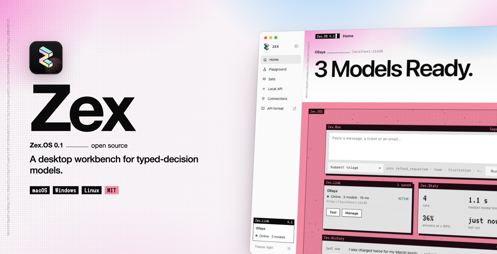
</p>

<p align="center">
  <a href="https://github.com/mahdiarfrm/zex/releases/latest">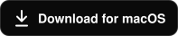</a>
  <a href="https://github.com/mahdiarfrm/zex/releases/latest"></a>
  <a href="https://github.com/mahdiarfrm/zex/releases/latest"></a>
  <a href="LICENSE"></a>
</p>

<p align="center"><b>Write a few typed questions, give Zex a message, and read every answer with its probability.</b><br>
Zex runs on your desktop and talks to the decision model you choose, on your machine or in the cloud.</p>

<br>

<picture>
  <source media="(prefers-color-scheme: dark)" srcset="docs/screenshots/home-dark.png">
  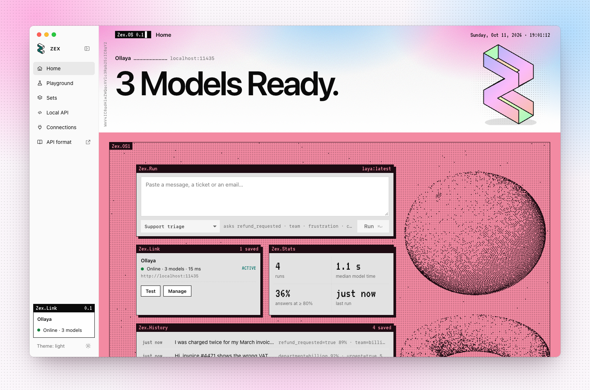
</picture>

## Why Zex

Chat models answer in sentences you have to parse. Typed-decision models answer the question you actually asked: **yes or no**, **one label out of several**, or **a point on a scale**, each with a calibrated probability. Zex is the workbench for them. You design the questions, try them on real messages, and see where the model is sure enough to act on its own and where a person should look.

- **Typed, not text.** Every answer is one of the options you wrote, with a probability. There is nothing to parse.
- **Sure, or not sure.** Set a confidence bar. Answers above it are marked **AUTO**, the rest **REVIEW**.
- **Bring your own model.** Run [Laya](https://github.com/NandhaKishorM/laya) locally with [Ollaya](https://ollaya.dev), point Zex at an [OpenJev](https://github.com/razorback16/openjev) server, or use a hosted API with your own key.

## A closer look

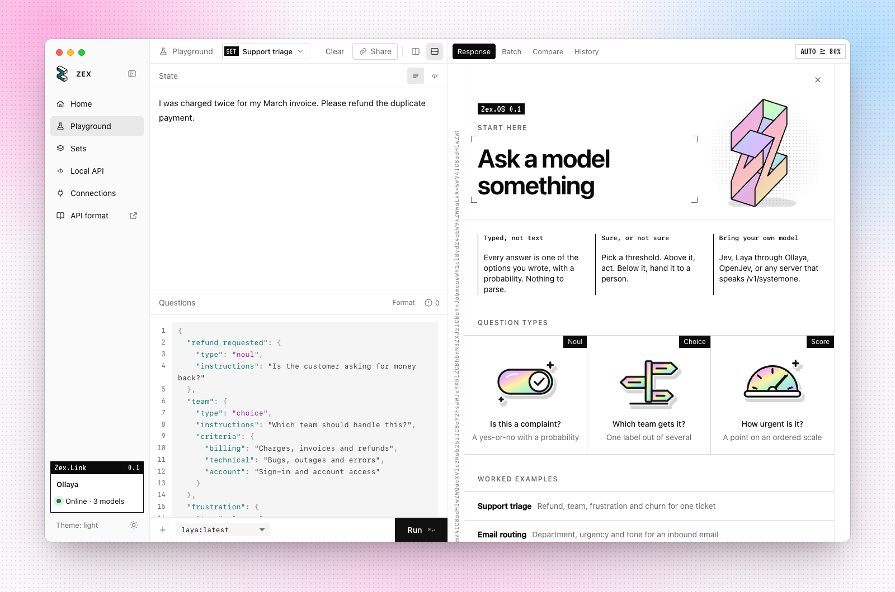

<p align="center"><sub><b>Playground.</b> A state, typed questions, and every answer with its distribution, timing and AUTO or REVIEW verdict.</sub></p>

## Built for real work

### Question sets

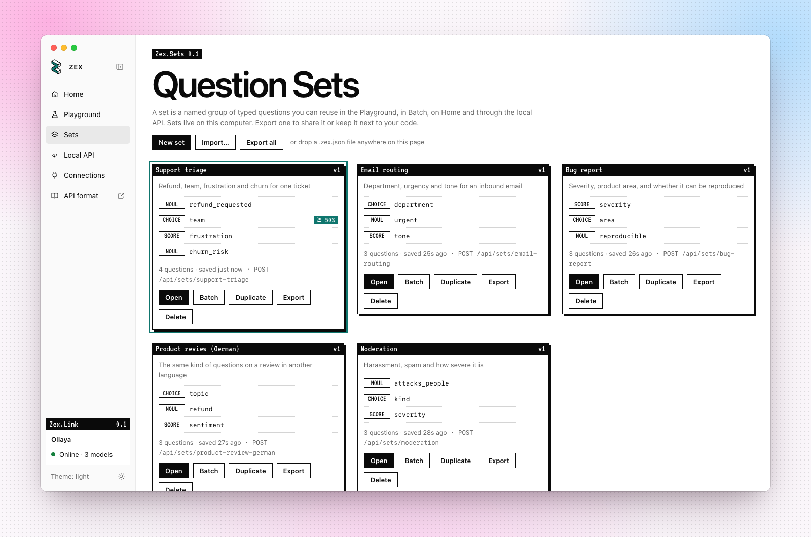

Save the questions you write as a **set**: a named, versioned group you can reuse in the Playground, in Batch, from Home and through the local API. A set can give each question its own AUTO threshold. Export a set as a `.zex.json` file to share it or keep it next to your code, and drop one onto the Sets page to import it.

### Files in, accuracy out

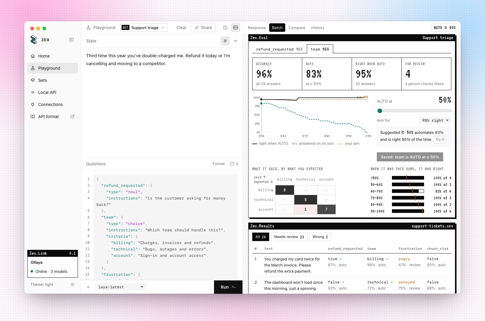

Drop a **CSV, TSV, Excel, JSONL or JSON** file into Batch. Zex finds the text column, runs every row with pause and resume, and exports the answers with their probabilities as CSV or JSONL.

If the file also has a column with the answer you expect, Zex measures how often the model is right, for each question:

- accuracy, and the share it can answer on its own at each threshold;
- a confusion matrix of what it said against what you expected;
- calibration: when it said 90%, how often it was right.

Pick the accuracy you need, and Zex suggests the threshold that automates the most while staying above it. One click saves that threshold to the set.

### A local API for every set

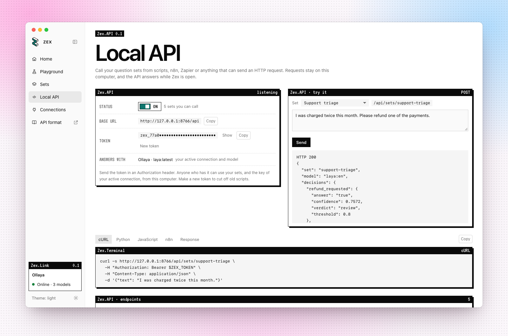

Turn on the **local API** and every set becomes an endpoint on your computer, ready for scripts, n8n, Zapier or anything else that can send an HTTP request:

```sh
curl -s http://127.0.0.1:18765/api/sets/support-triage \
  -H "Authorization: Bearer $ZEX_TOKEN" \
  -d '{"text": "I was charged twice this month."}'
```

```json
{
  "set": "support-triage",
  "decisions": {
    "team": { "answer": "billing", "confidence": 0.952, "verdict": "auto", "threshold": 0.8 },
    "refund_requested": { "answer": "true", "confidence": 0.836, "verdict": "auto", "threshold": 0.8 }
  },
  "all_auto": true
}
```

Requests use your active connection and the thresholds saved in the set, so `all_auto` tells your workflow when to act on its own and when to hand the item to a person. Send `{"items": [...]}` for up to 100 texts at once. `GET /api/sets` lists your sets.

## More

<table>
  <tr>
    <td width="50%">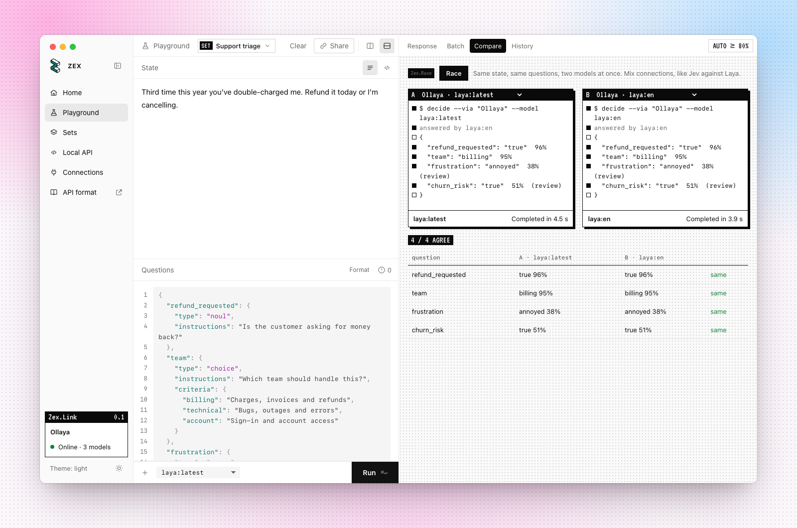</td>
    <td width="50%">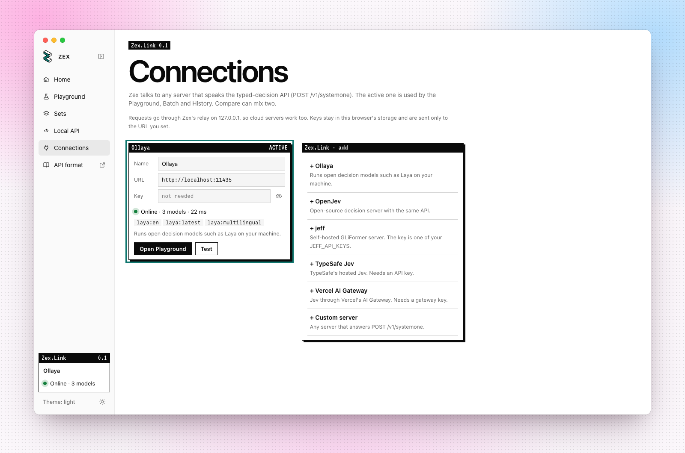</td>
  </tr>
  <tr>
    <td><sub><b>Compare.</b> Race two models on the same request, even from two different servers, and see where they agree.</sub></td>
    <td><sub><b>Connections.</b> Add, test and switch between model servers. Keys stay on your computer.</sub></td>
  </tr>
  <tr>
    <td width="50%">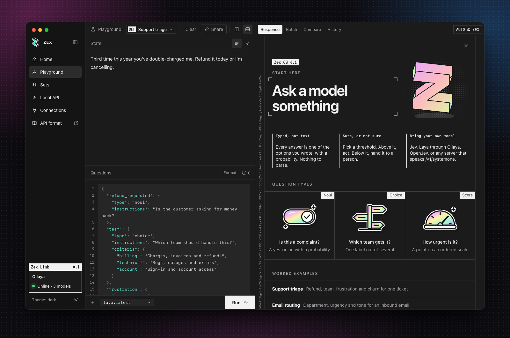</td>
    <td width="50%">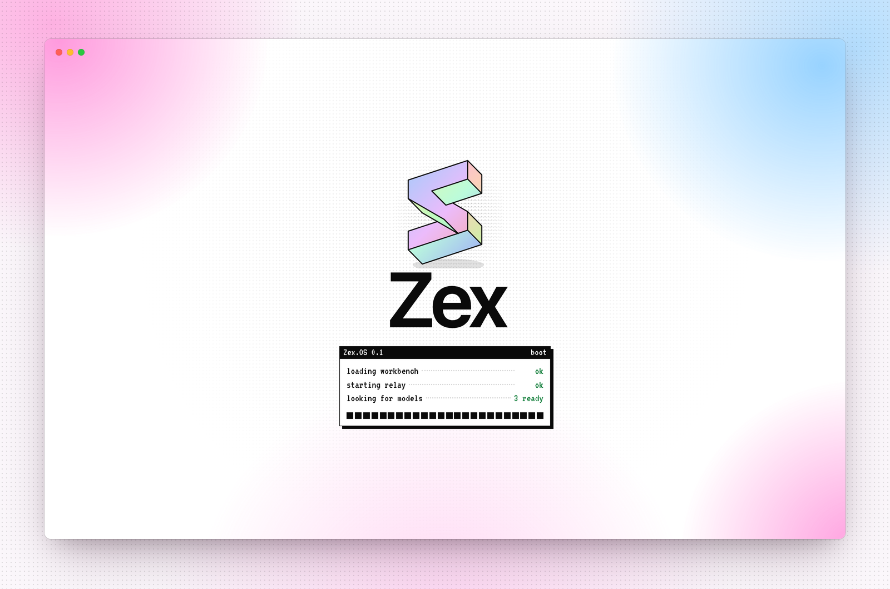</td>
  </tr>
  <tr>
    <td><sub><b>Start here.</b> The three question types and worked examples, one click from a blank Playground. Zex follows your system theme, or pick one in the sidebar.</sub></td>
    <td><sub><b>Boot.</b> Zex checks its relay and your models before you start.</sub></td>
  </tr>
</table>

## Download

| | System | File |
| --- | --- | --- |
| **macOS** | macOS 11 or newer, Apple silicon and Intel | `Zex-<version>-macOS.zip` |
| **Windows** | Windows 10 or 11, x64 | `Zex-<version>-Windows-x64.zip` |
| **Windows on ARM** | Windows 11 on ARM | `Zex-<version>-Windows-arm64.zip` |
| **Debian, Ubuntu** | x64 and ARM64 | `zex_<version>_amd64.deb`, `zex_<version>_arm64.deb` |
| **Other Linux** | x64 and ARM64, with WebKitGTK 4.1 | `Zex-<version>-Linux-x64.tar.gz`, `Zex-<version>-Linux-arm64.tar.gz` |

Get them from the [latest release](https://github.com/mahdiarfrm/zex/releases/latest).

<details>
<summary><b>First launch</b></summary>
<br>

- **macOS:** unzip and move **Zex** to Applications. The app isn't notarized yet, so the first time, right-click it and choose **Open**.
- **Windows:** unzip and run **Zex.exe**. If SmartScreen warns you, choose **More info**, then **Run anyway**. Zex uses the Microsoft Edge WebView2 Runtime, which comes with Windows 10 and 11. Without it, Zex opens in your browser instead.
- **Debian and Ubuntu:** `sudo apt install ./zex_<version>_amd64.deb`, then open Zex from your app menu.
- **Other Linux:** unpack the `.tar.gz` and run `./zex/install.sh`, which installs Zex for your user with its menu entry and icon. Zex needs WebKitGTK 4.1: `webkit2gtk4.1` on Fedora, `webkit2gtk-4.1` on Arch.

</details>

## Get started

1. **Run a model.** The quickest way is local: install [Ollaya](https://ollaya.dev) and run `ollaya pull laya`. Zex finds it at `http://localhost:11435`.
2. **Or connect one.** In **Connections**, add an OpenJev or jeff server by URL, or TypeSafe Jev or Vercel AI Gateway with your API key.
3. **Ask.** On **Home**, paste a message, pick a question set and press **Run**. Or open the **Playground** and write your own questions:

```json
{
  "refund_requested": { "type": "noul", "instructions": "Is the customer asking for money back?" },
  "team": { "type": "choice", "instructions": "Which team should handle this?",
            "criteria": { "billing": "Charges and refunds", "technical": "Bugs and outages" } },
  "frustration": { "type": "score", "instructions": "How upset is the customer?",
                   "criteria": ["calm", "annoyed", "angry", "furious"] }
}
```

## Private by design

- Zex has no account, no telemetry and no cloud of its own.
- Your history, settings and API keys stay in the app's local storage on your computer.
- A key is only ever sent to the server you added it for.
- The local relay listens on `127.0.0.1` only, and it forwards decision-model API paths only.
- The local API is off until you turn it on, answers on `127.0.0.1` only, and needs a token that you can replace at any time. Turning it off removes your sets and connection from its settings file.

## How it works

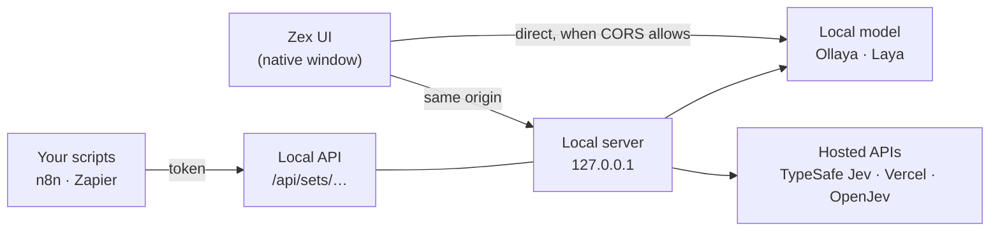

The interface is a single page (`web/index.html`) with no build step. Many hosted model APIs send no CORS headers, so a page can't call them directly, and a small local server relays those requests and serves the local API. The desktop app (`desktop/`, Go) embeds the page and the relay in one binary and shows them in a native window: WebKit on macOS, WebView2 on Windows, WebKitGTK on Linux. `server.py` is the same server in Python, for running from source.

## Build from source

```sh
./start.sh                  # Python 3.9+, no packages: opens Zex in your browser
go run ./desktop            # Go 1.26+: opens the desktop window
desktop/build.sh            # builds the macOS app (on a Mac), the Windows apps, and Linux (on Linux) into dist/
sh assets/build_icons.sh    # regenerates the icons (needs librsvg and ImageMagick)
```

<details>
<summary><b>Tests</b></summary>
<br>

```sh
go test ./desktop/                                  # server, relay and local API
ZEX_CONFIG_DIR=$(mktemp -d) python3 server.py --port 8766
# then, with Ollaya running, the browser click-through:
"/Applications/Google Chrome.app/Contents/MacOS/Google Chrome" --headless=new \
  --force-prefers-reduced-motion --virtual-time-budget=400000 \
  --dump-dom http://127.0.0.1:8766/tests/flows.html | grep -E "FAIL|passed"
```

</details>

<details>
<summary><b>Project layout</b></summary>
<br>

```
web/        the app: one HTML file, its font, and the embed for the desktop build
desktop/    the desktop app: local server, relay, native window and packaging (Go)
server.py   the same server for running from source (Python)
assets/     icon source and generated icons
tests/      browser click-through tests and a screenshot driver
docs/       README images and badges
```

</details>

## License

[MIT](LICENSE). The VT323 font is licensed under the SIL Open Font License (`web/fonts/OFL-VT323.txt`).

Zex is an independent project. It isn't affiliated with TypeSafe AI, Vercel, or the authors of the models it connects to.
